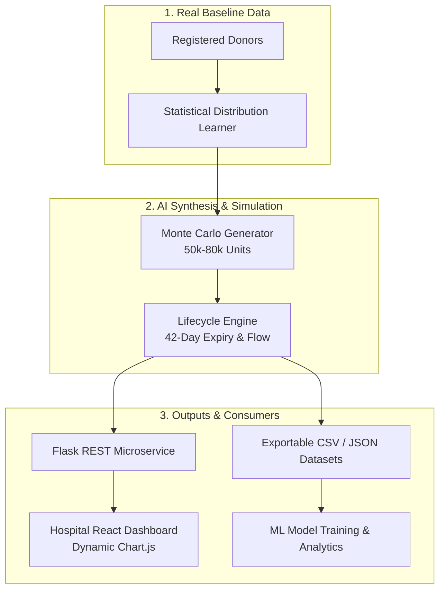

# 🩸 Blood Donation Platform — AI Synthetic Dataset & Simulation Engine

> **Major Project — Department of Information Science & Engineering, NNM College**  
> **Author:** Aditi Sandikar (NNM23IS006)

[](https://www.python.org/downloads/)
[](https://opensource.org/licenses/MIT)
[]()

---

## 📌 Overview

This repository hosts the **AI Synthetic Tabular Data and Time-Series Lifecycle Simulation Engine** designed for modern Blood Donation & Hospital Management Platforms. 

Instead of relying on static mock data or risking donor privacy by sharing sensitive personal health information (PHI), this engine:
1. **Learns Empirical Statistical Distributions** from actual registered donors (age, weight, blood group distribution, response rate, and donation frequencies).
2. **Synthesizes 50,000 to 80,000 Realistic Records in < 1 second** using Monte Carlo sampling under clinical guardrails.
3. **Simulates Biological Red Blood Cell (RBC) Shelf-Life (42 Days)**, modeling daily collections (inflow), emergency transfusions (outflow), and auto-expirations so dashboard graphs update dynamically day-by-day.

---

## 🏗️ Architecture



---

## 🧠 Mathematical Formulation

| Attribute | Statistical Distribution | Mathematical Formulation |
| :--- | :--- | :--- |
| **Blood Group & City** | **Categorical (MLE)** | $P(X = k) = \frac{\text{Count}(k)}{N_{\text{total}}}$ |
| **Age & Weight** | **Truncated Gaussian $\mathcal{N}(\mu, \sigma^2)$** | $f(x) = \frac{1}{\sigma \sqrt{2\pi}} e^{-\frac{1}{2}\left(\frac{x - \mu}{\sigma}\right)^2}$, clamped: $18 \le \text{age} \le 65$, $\text{wt} \ge 48$ kg |
| **Total Donations** | **Poisson Distribution** | $P(X = k) = \frac{\lambda^k e^{-\lambda}}{k!}$, where $\lambda = \text{Mean Donations}$ |
| **Response Rate** | **Beta Distribution** | $X \sim \text{Beta}(\alpha, \beta)$, bounded in $[40\%, 100\%]$ |
| **Shelf-Life & Status** | **Deterministic Step Function** | $\text{Status} = \text{'expired'} \iff t_{\text{curr}} > t_{\text{collection}} + 42\text{ days}$ |

---

## 📁 Repository Structure

```text
blood-donation-ai-generator/
│
├── src/                                  # Core Engine Logic
│   ├── __init__.py                       # Package definition
│   ├── distribution_learner.py           # Statistical parameter extraction
│   ├── generator.py                      # High-speed 50k-80k generator & CLI
│   ├── lifecycle_engine.py               # 42-day lifespan & inventory calculator
│   └── app.py                            # Flask REST API microservice
│
├── data/                                 # Sample data
│   ├── sample_real_donors.json           # Sample real input baseline
│   └── sample_synthetic_output.csv       # Preview synthetic dataset (500 units)
│
├── tests/                                # Test suite
│   ├── __init__.py
│   └── test_generator.py                 # Unit tests (speed benchmark, clinical rules)
│
├── .gitignore                            # Standard gitignore (ignores large dumps)
├── requirements.txt                      # Dependencies
├── LICENSE                               # MIT License
└── README.md                             # Documentation
```

---

## 🚀 Quick Start

### 1. Prerequisites & Installation

```bash
# Clone the repository
git clone https://github.com/AditiSandikar/blood-donation-ai-generator.git
cd blood-donation-ai-generator

# Install dependencies
pip install -r requirements.txt
```

---

### 2. Generate 80,000 Records via CLI

Run the standalone CLI generator to synthesize 80,000 units and export a preview sample:

```bash
python src/generator.py --count 80000 --output data/sample_synthetic_output.csv
```
> ⚡ *Benchmark: Generates 80,000 complete clinical records in ~0.20 seconds!*

---

### 3. Run the Flask Microservice

Start the microservice to provide endpoints for your web backend:

```bash
python src/app.py
```
> The API runs on `http://localhost:8001`

---

## 📡 API Reference

### 1. Health Check
* **Endpoint:** `GET /health`
* **Response:**
  ```json
  {
    "status": "healthy",
    "service": "Blood Donation AI Dataset & Simulation Engine",
    "cachedRecords": 50000
  }
  ```

### 2. Generate Dataset on Demand
* **Endpoint:** `POST /api/generate-dataset`
* **Request Body:**
  ```json
  { "count": 60000 }
  ```
* **Response:**
  ```json
  {
    "status": "success",
    "recordsGenerated": 60000,
    "executionTimeSec": 0.22,
    "sample": [...]
  }
  ```

### 3. Daily Dynamic Analytics (For Dashboard Graphs)
* **Endpoint:** `GET /api/daily-analytics?dayOffset=0`
* **Query Params:** `dayOffset` (Integer: `0` for today, `1` for tomorrow, `-1` for yesterday)
* **Response:**
  ```json
  {
    "targetDate": "2026-11-12",
    "dayOffset": 0,
    "totalSafeUnits": 2840,
    "stockByBloodGroup": {
      "A+": 620, "A-": 95, "B+": 840, "B-": 110,
      "AB+": 260, "AB-": 45, "O+": 910, "O-": 75
    },
    "collectedToday": 345,
    "transfusedToday": 280,
    "expiredToday": 41
  }
  ```

---

## 🧪 Running Unit Tests

Verify clinical rule enforcement, 42-day lifespan logic, and speed benchmarks:

```bash
python tests/test_generator.py
```

---

## 📄 License

This project is licensed under the [MIT License](LICENSE).
